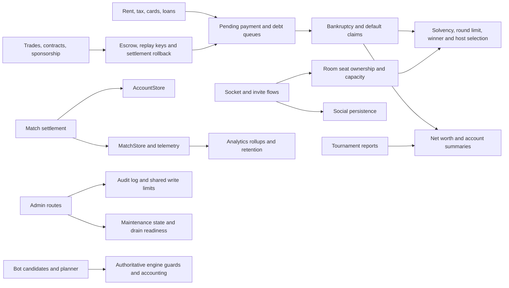

# Poorup backend bug audit — 21 October 2026

**Status: Stage 1 (review), Stage 2 (implementation), Stage 3 (peer closure) and Stage 4 (four reproduced fixes) complete.** All 30 backend scopes have a MiniMax verdict, the confirmed backend-only findings are implemented, and the deferred items are listed with their reasons. The work changed backend source, backend tests, the container `Dockerfile`, one backend ops script, and this report — no `public/`, `qa/`, or protected file was touched, and nothing was staged, committed, or pushed.

**MiniMax verdict coverage is 30/30, in two clearly different phases.**

- **15 pre-implementation peer verdicts** (Stage 1): scopes 01-10, 12, 13, 19, 24 and 28. These reviewed the source before any fix was written.
- **15 post-implementation peer checks** (Stage 3): scopes 11, 14, 15, 16, 17, 18, 20, 21, 22, 23, 25, 26, 27, 29 and 30. These re-checked the original claims against the *fixed* working tree, so they are peer checks of the implemented state, not pre-implementation reviews.

During Stage 1 those 15 later scopes were inspected by DeepSeek V4.1 Flash fallback source checks (the native task tool exposes no model selector and its config is not hot-reloaded, so MiniMax could not be selected then). Those fallback dispositions were never MiniMax peer verdicts; Stage 3 replaced them with MiniMax post-implementation peer dispositions, which are the ones recorded below.

**Model attribution for the implementation round (corrected).** The Stage 2 round used 30 ownership areas. **W01 (Docker storage layout), W02 (default-claim net worth) and W04 (open default-claim cap) completed under DeepSeek V4.1 Flash before the user stopped that run; the other 27 (W03 and W05-W30) were stopped unfinished and were then completed under MiniMax M3.1 Flash Free after the model switch.** Exactly one OpenCode thread was used throughout; it was created as a single T3 delegated orchestrator task, and its scope/fix workers were native OpenCode subagents rather than separate T3 tasks or OpenCode sessions. No DeepSeek work ran after the user's switch.

## Scope and method

- Repository: `C:\Users\jerem\Documents\GITHUB\Poorup`, branch `development`, heavily dirty working tree (171 entries before the report-only edit). Current working-tree source was inspected, not git `HEAD`.
- Scope: backend correctness, persistence, authorization, economy, game-state transitions, server resource use, and internal measurement. Frontend behavior, UX, and findings whose only effect is a client-facing response/event payload are excluded.
- Stage 1 (review) ran no tests and edited no source. Stage 2 (implementation) ran the test manifest, the lint script and `git diff --check`, and edited backend source, backend tests, `Dockerfile`, one backend ops script and this report. Stage 3 (peer closure) ran read-only checks and edited only this report. Nothing was reset, checked out, cleaned, staged, committed or pushed at any point. `docs/ops/protected/HACKATIME-PAUSE.md` and its folder were not modified, and no content from them is used in this report.
- No `public/`, `qa/`, or browser-facing payload change was made. Where a fix would have altered a published payload it was reworked server-side instead: the short position's opening fee moved to a private ledger, and the election nonce is filtered from the published event.
- Line numbers are current working-tree positions at the time of the relevant check. The tree is dirty and lines may move; re-locate by symbol before editing.
- The initial DeepSeek V4.1 Flash source audit covered all 30 partitions. The review round reconciled peer dispositions and re-checked accepted evidence; it did not redo the full source audit.

## Review provenance and limitations

- **Pre-implementation MiniMax peer verdicts (15 scopes):** 01, 02, 03, 04, 05, 06, 07, 08, 09, 10, 12, 13, 19, 24, 28. These were produced before any fix was written and are preserved verbatim below.
- **Stage 1 fallback source checks (15 scopes, DeepSeek V4.1 Flash, superseded):** 11, 14, 15, 16, 17, 18, 20, 21, 22, 23, 25, 26, 27, 29, 30. The native task tool exposes no model selector and its config is read once at startup, so MiniMax could not be selected in that session without a new session or a T3 delegated task, both excluded by the brief. These were read-only source inspections, not MiniMax peer verdicts; they informed the fix queue and have now been replaced by the MiniMax post-implementation checks below.
- **Post-implementation MiniMax peer checks (15 scopes):** 11, 14, 15, 16, 17, 18, 20, 21, 22, 23, 25, 26, 27, 29, 30. Each reviewer re-read the original claims for its scope against the fixed working tree, classified every claim, cited the current file:line and the covering regression test, and reported anything still open as a deferred candidate. The scope-to-reviewer mapping and the earlier r4 interruptions (scopes 11, 14, 15, 16, 17, started and stopped before any result) are recorded in the thread; nothing from those interrupted attempts was reused.
- **Consequence:** 30/30 scopes now carry a MiniMax verdict — 15 pre-implementation, 15 post-implementation. The post-implementation checks are the authoritative dispositions for the 15 later scopes, because they were taken against the code that now ships.
- **Limitations that remain.** The native task tool has no model parameter, so model selection follows the thread; the 15 pre-implementation verdicts were taken on the pre-fix tree and were not re-checked against the final code, and the 15 post-implementation checks are a review of an implemented state, which cannot by itself establish that the original claim was correctly framed.

## Cross-component paths

The parked-debt invariant is now confirmed, not a candidate: `pendingPayment` is created by rent/tax/card/other charges, but `inDebt` is initialized false and never set. Solvency, winner, bankruptcy-conclusion, and host-selection paths read `inDebt`; `endGame` clears the pending payments after crowning. This is the highest-impact match-state defect in the audit.

## Highest-impact confirmed defects

1. **Container startup path conflict — deployment blocker.** `Dockerfile:25-26` places `POORUP_BACKUP_DIR` below `POORUP_DATA_DIR`; production storage validation at `server/serverStorePaths.js:88-94` rejects overlapping paths before the server listens. The default image therefore fails its own storage assertion. Repair with sibling directories under the mounted volume, e.g. `/var/lib/poorup/data` and `/var/lib/poorup/backups`.
2. **Parked debt is invisible to solvency gates.** `server/gameLogic.js:148` initializes `inDebt` false; `openDebtSettlement` at `server/gameLogic.js:1183-1211` records `pendingPayment` and its queue without setting it; the only assignment found is the clear at `server/bankruptcyApi.js:66`. Solvency/winner reads at `server/gameLogic.js:998-1000` and `1421-1427`; bankruptcy conclusion at `server/bankruptcyApi.js:372-386`; host election at `server/rooms.js:291-305`. `endGame` clears pending payments at `server/gameLogic.js:1455-1456`, so an unpaid claim can be erased after a debtor is selected as winner.
3. **Match result retry is suppressed after an account write failure.** `server/accountStore.js:1014-1035` mutates account stats/history and records the match ID before `persist()`; the idempotency check is at `server/accountStore.js:364-389`. A failed write leaves the in-memory ID behind, so a retry skips the durable write. Runtime caller/retry: `server/socketRuntime.js:583-599` and `505-516`; separate match persistence: `server/matchStore.js:234-256`.
4. **Invite acceptance can leave an unmapped live seat.** `server/socketRuntime.js:1435-1457` inserts/reconnects the target-room seat before `socialStore.respondInvite`; a thrown persistence error prevents socket-room remapping and joining. Source: `server/socialStore.js:386-397` and rollback helper `174-186`; seat insertion `server/rooms.js:376-385` and `491-515`. Host/bot side effects also are not restored on the throw path.
5. **Account deletion can leave durable state inconsistent or erase without a working rollback.** Request/cancel paths persist account state and then revoke sessions without a durable rollback (`server/accountDeletion.js:56-61`, `76-81`); purge snapshots linked stores but `SocialStore` exposes only `snapshot()` and no restore, while `MatchStore`/`AchievementStore` expose neither (`server/accountDeletion.js:108,133`; `server/socialStore.js:164-172`). Session revocation itself mutates maps before persisting (`server/sessionStore.js:201-246`).
6. **Margin maintenance blocks risk-reducing actions.** `server/marketLogic.js:24` applies the maintenance guard to every market order, including sells that would raise cash to cure margin; `server/marketExpansion.js:133-143` blocks reduce/cover/exercise/close for any loan-backed seat because the taint check ignores the operation. A levered, cash-poor seat can be forced into liquidation while unable to de-risk.
7. **Finished matches remain mutable.** `endGame` sets `started=false` but leaves the room mapped and keeps contracts, equity shares, properties, and `globalEvent` live (`server/gameLogic.js:1447-1456`). Property mortgage/unmortgage (`server/propertyApi.js:204-221`), contract verbs (`server/contractLogic.js:56-62,266-289,623-647,864-880`), global-event votes/resolution (`server/globalEventsApi.js:288-330`), vote-kick start/remove (`server/roomVoteKickRuntime.js:165-181`), and late bot decisions (`server/socketRuntime.js:995-1007`) can still move cash or change the roster after the winner is fixed.

## Scope inventory and dispositions

| Scope | Area | Peer review | Disposition summary |
|---:|---|---|---|
| 01 | Bootstrap, configuration and routing | MiniMax (pre-impl.) | ACCEPT: Docker storage overlap; `/privacy` publication and relative-path/env items are policy/lower severity. |
| 02 | Admin routes, authorization and audit log | MiniMax (pre-impl.) | ACCEPT: separate write budgets per route family; unreadable audit log can be clobbered; denied bearer request can lose replacement cookie. |
| 03 | AI provider configuration and endpoints | MiniMax (pre-impl.) | ACCEPT: test/save race, stale in-flight failures, over-broad health reset, unusable JSON budget, decryption/list failure, labels/validation. |
| 04 | Account authentication and recovery | MiniMax (pre-impl.) | ACCEPT: socket bearer TTL gap, recovery-email race, reset-token ordering, mail key trim, best-effort revocation. |
| 05 | Account deletion, export and erasure | MiniMax (pre-impl.) | ACCEPT: backup scrub scope, CWD backup path, partial purge/rollback, cancel/request gaps, export/designs gaps; merge scope 06. |
| 06 | Persistence, backups and restore | MiniMax (pre-impl.) | ACCEPT: anonymization strips wrong credentials, temp/sidecar escape, irreversible partial purge, restore guard blind, coverage can omit stores. |
| 07 | Metrics, telemetry and retention | MiniMax (pre-impl.) | ACCEPT: timer overflow to 1 ms, prune not flushed, airport telemetry rejected, mixed error-rate denominator, result-shape drift, stale gauges. |
| 08 | Analytics projection and rollup persistence | MiniMax (pre-impl.) | ACCEPT: `marketComplexity` dropped, non-object rollup entries can throw; purge rollback merges scope 05. |
| 09 | Account socket and room request normalization | MiniMax (pre-impl.) | ACCEPT: create-room checks clientId not accountId and releases seat before final checks; join lockout can inspect wrong room. |
| 10 | Game/social socket handlers | MiniMax (pre-impl.) | ACCEPT: friends leaderboard budget/quadratic scans, player-card budget, notification-read cost, unbounded pending/report growth, summary scans; cookie push excluded. |
| 11 | Socket runtime and event lifecycle | MiniMax (post-impl.) | 7 fixed, 1 deferred, 2 rejected, 1 duplicate. Invite rollback, retained borrower notices, post-game guards, the telemetry field and the duplicate account seat are fixed; teardown settlement deferred; timer cleanup and the `onAny` escape rejected. |
| 12 | Room registry, seat ownership and presence | MiniMax (pre-impl.) | ACCEPT: bankrupt retained seats omitted from capacity/bot math; reclaim can pick oldest disconnect; idle watcher tracks wrong responder; duplicate scope 09. |
| 13 | Room voting, kick lifecycle and pub/sub | MiniMax (pre-impl.) | ACCEPT: vote replay/cooldown maps survive match end; reclaim ordering; vote-state claim rejected; pub/sub latent. |
| 14 | Social persistence and identity | MiniMax (post-impl.) | 8 fixed, 2 deferred, 1 rejected, 2 duplicate, 1 out of scope. Redaction, friend removal, prune, normalization, achievement isolation, the participant guard, the deactivated/blocked filter and the null-entry filter are fixed; deletion rollback and leaderboard staleness deferred. |
| 15 | Authoritative engine and rules | MiniMax (post-impl.) | 5 fixed, 2 deferred, 1 rejected, 1 duplicate, 1 policy. `inDebt` lockstep, head+queue gates, roller priority, endgame ordering, unclamped ranking and the auction debt guard are fixed; the bank-run re-check and the jail-fine gate deferred. |
| 16 | Cards and server-owned card logic | MiniMax (post-impl.) | 4 fixed, 1 deferred, 2 rejected, 1 policy. The low-tax collect, `zeroCashReached`, recipient debt settlement and the roller-queue fix are in; the deck and low-tax-snapshot claims rejected; the malformed-card hardening deferred. |
| 17 | Bankruptcy, bank accounts and net worth | MiniMax (post-impl.) | 5 fixed, 2 deferred, 2 rejected, 1 duplicate, 1 policy, 1 out of scope. Claim cap, clamp tie, placement crown, default claims in net worth, estate settlement and the bank projection are fixed; D10 stays out of scope. |
| 18 | Loans, economy and market expansion | MiniMax (post-impl.) | 10 fixed, 1 duplicate, 2 policy. De-risking, basis, forced liquidation, short fee, buy-in freeze, queue order, replay, seizure and the option faucet are fixed; secured default and loan-backed bank spend stay policy. |
| 19 | Auctions and bot auction policy | MiniMax (pre-impl.) | ACCEPT construction/rent-cap omission, incomplete acquisition facts, tournament game omission; jail-fine/escrow rejected as unreachable. |
| 20 | Trades, contracts, property and rent | MiniMax (post-impl.) | 8 fixed, 1 rejected, 2 policy. The counter block, credit-and-settle, stopped-match guard, loan-backed repayment, equity cap and atomic settlement are fixed; the rent claim rejected, the group-trade question left policy. |
| 21 | Sponsorship, tiles and airport | MiniMax (post-impl.) | 4 fixed, 2 rejected, 3 duplicate, 2 policy. Contribution replay, the debt gates, the zero-need request and the non-cash rollback are fixed; the airport defects rejected; the telemetry drop is still open. |
| 22 | Bot API, advisor and timing | MiniMax (post-impl.) | 2 fixed, 1 rejected, 4 duplicate, 3 policy. The rematch/destroy staleness guard and the empty payment board are fixed; the provider roots stay counted under scope 03. |
| 23 | Bot decisions and table state | MiniMax (post-impl.) | 8 fixed, 2 rejected, 1 policy. Depth-two pruning, the accept preflight, event utility, the live-seat context, the dead counterpart, contract parity, planner seats and the open-offer filters are fixed. |
| 24 | Bot planning and board/economy forecasts | MiniMax (pre-impl.) | ACCEPT option/equity/event-house/jail/reserve/auction-escrow planner gaps; pass-start and low-tax snapshot rejected. |
| 25 | Bot candidates, contracts and trade valuation | MiniMax (post-impl.) | 6 fixed, 1 rejected, 2 duplicate, 2 policy. The contract-counter obligations, acceptance parity, the counter ladder, the proposal collectors and one shared valuation are fixed. |
| 26 | Bot tournament and simulation | MiniMax (post-impl.) | 11 fixed, 3 deferred, 1 duplicate. Canonical worth, market P&L, null placement, shadow counts, NaN totals, env threading, the advisor reset, seeds, stratum keys and the completion classes are fixed. |
| 27 | Global events and server content | MiniMax (post-impl.) | 5 fixed, 1 deferred, 2 rejected, 2 policy. Stopped-match ballots, the stale-ballot guard, combination effects and hooks, and the activation settlement are fixed; disconnected-seat settlement stays deferred. |
| 28 | HTTP/socket rate limits and address policy | MiniMax (pre-impl.) | ACCEPT blank HTTP window, join-failure saturation, bucket migration, maintenance IPv6 key; prefix sizing is policy. |
| 29 | Maintenance state and drain control | MiniMax (post-impl.) | 6 fixed, 3 deferred, 2 duplicate, 2 policy. The legacy drain, corrupt boot, unknown round count, the persist retry, the waiting-room wait and the internal audit trail are fixed. |
| 30 | Cross-module backend boundaries | MiniMax (post-impl.) | 3 fixed, 4 deferred, 4 duplicate, 1 policy. The match-result retry, the deletion request/cancel path and session revocation are fixed; the purge restore, A4 and the recovery expiry deferred. |

## Pre-implementation MiniMax dispositions (15 scopes)

These are the original Stage 1 MiniMax peer verdicts, taken on the source before any fix was written. They are preserved as the record of what was claimed at review time; the 15 post-implementation checks above cover the other scopes.

- **Scope 01 — ACCEPT:** default image storage paths conflict (`Dockerfile:25-26`; assertion at `server/serverStorePaths.js:92-94`). The documented `/privacy` route is a publication decision; relative-path/environment-file observations are lower-severity and need policy/ops confirmation.
- **Scope 02 — ACCEPT:** write limits are separate per admin route family (`server/adminOpsGuard.js:32-68`); an audit-log read failure can clobber the only copy on non-corruption errors, while corrupt JSON is quarantined; a denied admin request can consume a legacy bearer without delivering its replacement cookie (`server/adminOpsGuard.js:42-53`, `server/server.js:685-699`). Pseudonym fallback key and generic 4xx body handling remain policy/low-severity.
- **Scope 03 — ACCEPT:** provider-test/save race, reconfigured in-flight answers counted as provider failures, over-broad health reset on active-profile edits, and unusable JSON consuming decision budget. Provider-list decryption failure is accepted; the test route returns 400 rather than 500; the POST 201 update response is client-contract and excluded. Additional accepted findings: empty numeric fields clamp to minimum, dead timeout env names, unenforced `enabled:false`, protocol-probe misclassification, duplicate labels.
- **Scope 04 — ACCEPT:** socket legacy-bearer TTL is missing; older recovery-email delivery can overwrite newer pending state; reset retries invalidate the prior delivered link before replacement delivery; mail API key is not trimmed; password-reset session revocation persistence errors are swallowed. Socket-only cookie logout remains a low policy question because the shipped client also calls HTTP logout.
- **Scope 05 — ACCEPT:** backup scrub affects surviving accounts; empty backup path resolves to CWD during erasure; partial multi-store purge plus incomplete rollback can leave an active/cancellable account with deleted data; cancel/request paths have persistence rollback gaps; bulk purge misses quarantine/sidecar and classification cases. Export `designs` is empty; export depth is policy. Merge credential scrub/rollback with scope 06 and session persistence with scope 04.
- **Scope 06 — ACCEPT:** backup anonymization strips other accounts' credential fields, fails to strip the target's actual fields, and misses `sessionTokenHash`; backup temp files and some excluded-store corrupt sidecars escape erasure; failed erasure may irreversibly purge stores while the account remains cancellable; restore's live-directory guard is blind without `POORUP_DATA_DIR`; backup coverage can silently omit stores when the data path is unset. Room-ID item out of scope; fsync/observability low severity.
- **Scope 07 — ACCEPT:** unbounded retention/backup intervals can overflow Node timers to 1 ms; analytics prune is not flushed; airport-flight telemetry is rejected at kind and payload allowlists; error-rate numerator combines HTTP and socket errors while the denominator is socket actions; overlapping retention results have different shapes; active-room gauges can stay stale after destroy.
- **Scope 08 — ACCEPT:** settlement telemetry drops `marketComplexity`, splitting a non-basic match across rollup rows (`server/socketRuntime.js:353-359` vs `333-343`); non-object entries inside rollup dimensions/actors can still throw in queries (`server/analyticsRollupStore.js:440-450,562,646`). Purge rollback merges scope 05; prune finding narrowed to quiet-server durability lag; missing drilldown scope and always-zero health counters excluded as frontend-facing.
- **Scope 09 — ACCEPT:** create-room checks clientId but not accountId and performs the check after releasing a seat; create-room can hard-settle a started-game seat as bankruptcy instead of disconnect grace; join lockout reconnect detection can inspect the wrong room. First two are highest priority; the third is distinct.
- **Scope 10 — ACCEPT:** friends leaderboards bypass recompute budgets and use O(N·M) scans; signed-in player-card reads have no budget; notification-read is an unbudgeted full-store clone/write; incoming pending friend requests and reports can grow without global bounds; social-summary recomputes mutual-friend counts at high complexity. Cookie-session live-push routing is excluded because it changes realtime client delivery.
- **Scope 12 — ACCEPT:** bankrupt retained human seats are excluded from capacity/bot math and can create over-capacity tables; account reclaim can choose the oldest disconnected seat; idle watcher can monitor `toPlayerId` instead of the contract responder. Blocked-candidate early abort rejected as unreachable; create-room duplicate-seat/seat-release is a duplicate of scope 09.
- **Scope 13 — ACCEPT:** vote-kick replay/cooldown maps survive match end/rematch (`server/rooms.js:642-645`; `server/roomVoteKickRuntime.js:65,99-125,232-234`), so a retry can return a stale "vote open" result and cooldowns leak into the next match. `findRestoreRoomFor` can prefer a refreshed lobby deadline over the disconnected started-game seat (`server/rooms.js:1003-1020`, `server/socketRuntime.js:1280-1285`); merge with scope 12. The "vote state missing from room-state" claim and unused spectator flags were rejected; state is in `getRoomSummary` at `server/rooms.js:727`. Pub/sub byte-size/clone costs are latent because there is no production publish caller.
- **Scope 19 — ACCEPT:** bot auction completion values can miss construction blocks and rent caps; auction acquisitions omit housing-bubble and zero-cash facts; Bank Run pause can consume doubles; tournament simulation omits the game parameter and measures a different auction policy. Jail-fine/bid-escrow collision rejected as unreachable under current turn guards; combination-event behavior and per-difficulty auction horizon need policy.
- **Scope 24 — ACCEPT:** planner accounting omits held options, misvalues equity contracts, ignores event-adjusted house resale and live-seat filtering, mis-models jail fines, max-hit reserve, and auction escrow, and omits low-tax effects only where currently reachable. Pass-Start catch-up omission rejected/unresolved; findings are bot-decision accuracy issues, not frontend changes.
- **Scope 28 — ACCEPT:** blank HTTP window config can collapse to 1 s; join-failure throttling fails open at bucket saturation; overflow-to-real-bucket migration discards spent budget; maintenance unlock failures use raw IPv6 rather than the normalized /64 key. IPv6 prefix sizing remains policy.

## Post-implementation MiniMax peer dispositions (15 scopes)

These are the **Stage 3 MiniMax peer checks** of scopes 11, 14, 15, 16, 17, 18, 20, 21, 22, 23, 25, 26, 27, 29 and 30, taken against the **fixed** working tree. They supersede the Stage 1 DeepSeek fallback source checks for these scopes (those were never MiniMax verdicts). `DUPLICATE` means the root is counted under another scope; it is carried in the fix queue once. Every claim was classified as ACCEPT-AND-FIXED, ACCEPT-BUT-DEFERRED, REJECT, DUPLICATE, POLICY or OUT OF SCOPE, with the current file:line and the covering regression test.

**Totals across the 15 scopes: 172 claims classified — 92 ACCEPT-AND-FIXED, 19 ACCEPT-BUT-DEFERRED, 17 REJECT, 22 DUPLICATE, 20 POLICY, 2 OUT OF SCOPE — plus 27 new DEFERRED-CANDIDATE findings (recorded below, not fixed).**

- **Scope 11 — socket runtime/event lifecycle** (7 fixed, 1 deferred, 2 rejected, 1 duplicate): D7 post-game verbs fixed at `server/socketRuntime.js:1048-1053` (`socketRuntime.test.js` "a late bot decision does not mutate a finished match"); F2 invite rollback at `server/socketRuntime.js:1477-1537` ("invite acceptance unwinds the seat when the store fails"); J2 borrower notice retained at `server/socketRuntime.js:585-615` ("keeps a borrower notice until the seat has a socket"); N12 telemetry keeps `marketComplexity` at `server/socketRuntime.js:357-367`; the create-room duplicate seat fixed at `server/serverSocketAccount.js:450-455` (`seat-identity.test.js` "A1 create-room cannot give an account a second seat"); A3 is a DUPLICATE of scope 04 (TTL now enforced at `server/accountStore.js:727-743`, `account-session-audit.test.js` "a stale hash session is rejected"); F7 fixed at `server/socialStore.js:362-378`. The teardown-settlement candidate is ACCEPT-BUT-DEFERRED — `server/socketRuntime.js:877,908-918` attempts `settleCompletedRoom` but no regression test covers it. REJECT: one-shot timer cleanup (`server/socketRuntime.js:1741-1743` still clears intervals only; per-room one-shots are cleared at `:879-890`) and the `socket.onAny` exception escape (no throw path demonstrated).
- **Scope 14 — social persistence/identity** (8 fixed, 2 deferred, 1 rejected, 2 duplicate, 1 out of scope): H1 whole-word redaction at `server/socialStore.js:131-149`; H2 accepted-friendship-only removal at `:467-498`; F7 at `:362-378`; H7 load normalization at `:211-287,380-394`; H3 announcement made best-effort at `server/socketSocialApi.js:223-266,271-280` ("a failed achievement persist does not escape the settlement"); H4 participants guard at `server/socketSocialApi.js:154`; H5 deactivated/blocked filter at `:164-169`; H6 null-entry filter at `server/achievementStore.js:44-55,176-186`. H8 is a DUPLICATE of scope 10. ACCEPT-BUT-DEFERRED: the deletion-rollback residual (`server/accountDeletion.js:18-20,142-143`) and the cached-leaderboard staleness (`server/serverSocketSocial.js:24,540-552`). REJECT: the patrol-result ordering (feature flag pinned off, `server/accountStore.js:83`). OUT OF SCOPE: internal ids in friend-summary payloads.
- **Scope 15 — authoritative engine/game rules** (5 fixed, 2 deferred, 1 rejected, 1 duplicate, 1 policy): D1 fixed at `server/gameLogic.js:1019-1027` plus `server/bankruptcyApi.js:397-415` and `server/rooms.js:317` (`game-invariant-regressions.test.js` "parked debt marks the debtor in debt until the claim clears"); D2 fixed at `server/gameLogic.js:1002-1015,719,1235-1247,1446` ("roll and end gates see queued debt, not just the head claim", "the active roller debt is promoted ahead of another payer claim"); D6 at `:1487-1493` ("final net-worth snapshot is taken after pending-debt cleanup"); D4a ranking on the unclamped total at `:1039-1045` (`round-limit.test.js` "a negative-worth seat must not tie with a zero seat at the clamped display value"); D8 at `server/auctionApi.js:80-94,149-154` ("a seat with an unpaid debt cannot bid"). ACCEPT-BUT-DEFERRED: the bank-run auction re-check (deliberately reverted to the repo-pinned T13 intent) and the jail-fine/jail-free debt gate (`server/gameLogic.js:788-813,773-779,827-836` have no head+queue gate). DUPLICATE: retained-seat capacity (scope 12). REJECT: turn/doubles/round-limit claims. POLICY: the lifetime of claims owed by a departed player.
- **Scope 16 — cards and server-owned card logic** (4 fixed, 1 deferred, 2 rejected, 1 policy): K2 low-tax in `collectFromEach` fixed via `cardRewardAmount` at `server/cardApi.js:127-130,393` (`applyCard.test.js` "collectFromEach honors the low-tax discount"); K3 `zeroCashReached` at `server/cardApi.js:364,401`; K4 recipient debt settlement at `:356,365,373-385` ("payEach settles a recipient parked debt"); the active-roller queue stranding fixed in `server/gameLogic.js:1235-1247`. REJECT: the deck/reshuffle claim (`server/cardApi.js:83-90` refills excluding held cards) and the low-tax snapshot claim (the discount is read live at apply time). POLICY: whether a disconnected seat still participates in pay-each/collect. ACCEPT-BUT-DEFERRED: the malformed-card-amount hardening (`server/cardApi.js:207-210` still passes a raw amount that can park a NaN claim).
- **Scope 17 — bankruptcy, bank accounts and net worth** (5 fixed, 2 deferred, 2 rejected, 1 duplicate, 1 policy, 1 out of scope): D3 fixed at `server/bankruptcyLogic.js:227-235,257-263` ("a full ledger of open claims rejects the new default instead of evicting one"); D4 clamp tie fixed at `server/gameLogic.js:1041` and the placement crown at `server/accountStore.js:275-286` ("placement ranks the crowned winner first among contested seats", golden "bankrupt winner placement order"); D5 default claims in net worth at `server/netWorth.js:161-170` ("an open default claim is worth one contract"); D9 estate cash settling the creditor's debt at `server/bankruptcyApi.js:149,162-179`; the bank-account projection at `server/bankAccountApi.js:42-45,57-63,93` ("the projection mirrors the refusals of the upgrade action"). D10 is OUT OF SCOPE (feed text). REJECT: the liquidation-estimate drift and the option-intrinsic claim. POLICY: the bank-action debt gate. DUPLICATE: the engine debt root (scope 15).
- **Scope 18 — loans, economy and market** (10 fixed, 1 duplicate, 2 policy): E1 fixed at `server/marketLogic.js:27` and `server/marketExpansion.js:140` ("a sell stays available while margin maintenance is due"); E2 basis at `server/marketExpansion.js:183`; E3 forced liquidation at `:528-586` (`market-settlement-audit.test.js`); E4 short fee at `:248,269,280`; E5 short-default freeze at `server/marketLogic.js:31` ("a spot order is refused while short buy-in debt is unpaid"); E6 queue ordering at `server/loanLogic.js:279-337` ("a bank default waits behind the debt the seat already owes"); E7 replay at `:137-139`; E8 seizure multiplier at `:355-360`; the option-pricing faucet closed at `server/marketExpansion.js:326,359` ("no open-option candidate is advertised without a server pricing policy"). DUPLICATE: the claim-ordering root (scope 17). POLICY: secured bank default non-recourse and bank-tier loan-backed cash.
- **Scope 20 — trades, contracts, property and rent** (8 fixed, 1 rejected, 2 policy): T1 fixed at `server/botCandidates.js:175-177` ("a pending payment does not block the counter"); T2 fixed through the shared helper `server/contractLogic.js:78-86` with call sites `:471,1003,1183` ("a loan repayment settles the lender's own parked debt", "an equity rent share settles the holder debt only after every share is paid"); T3 fixed at `server/contractLogic.js:68-71`, `server/tradeApi.js:132-134,282`, `server/propertyApi.js:235` ("every contract verb is refused once the match is not running"); T4 at `server/contractLogic.js:981-983`; T5 at `:1160-1183` ("equity payouts never exceed the rent collected"); F6 atomic settlement at `server/tradeApi.js:43-120,407-434` and `server/contractLogic.js:789-860` ("a failed trade settlement moves no cash and no deed"); the property purchase now uses spendable cash at `server/propertyApi.js:123`. REJECT: the wrong-actor/wrong-amount rent claim (`server/tileApi.js:232-238`). POLICY: the group-building restriction on trading a bare deed, and the memoized contract-proposal replay.
- **Scope 21 — sponsorship, tiles and airport** (4 fixed, 2 rejected, 3 duplicate, 2 policy): T18 fixed at `server/sponsorshipApi.js:272-306,456-462` ("a replayed contribution does not debit twice", "the alias request id settles the new escrow"); T19 at `:118-119,142-147,172,253-255` ("a sponsor or buyer in debt cannot fund or accept"); T20 at `:35-37`; T21 at `:327-369` (the rollback now restores the housing-bubble fact, full groups and the turn flags). REJECT: the cash/obligation rollback defect and the airport wrong-actor/wrong-amount claims. DUPLICATE: post-game property mutation (scope 20), queued-debt spending (scope 15) and the airport-flight telemetry drop (scope 07 — **still dropping**, see candidates). POLICY: a mortgaged airport owner paying the fare, and airport fee edits during a pending trade.
- **Scope 22 — bot API, advisor and timing** (2 fixed, 1 rejected, 4 duplicate, 3 policy): L1 fixed across the advisor snapshot (`server/advisorLogic.js:404,450,550,559`) and the runtime guard (`server/socketRuntime.js:1026-1056`) ("an advisor answer from a previous game is discarded after a rematch", "destroyed room stops the in-flight bot decision"); L2 fixed at `server/botAdvisor.js:334-350` ("the board shows the tiles the choices refer to"). The three provider roots and the dead-seat advisor context are DUPLICATES of scope 03 and scope 23. REJECT: an authorization or rate-limit bypass (`server/aiProviderRoutes.js:20-26,46`, `server/adminOpsGuard.js:44-83`). POLICY: the unclamped operator timeout, the game-budget cap eviction, and per-process rather than cluster-wide AI call caps.
- **Scope 23 — bot decisions and table state** (8 fixed, 2 rejected, 1 policy): T6 fixed at `server/botLogic.js:631-638,642-649` ("a live offer at the negotiation limit is not pruned"); T7 preflight at `:230-244` ("trade acceptance preflights the settlement the engine will run"); T8 per-event utilities at `:112-156` ("event votes weigh the seat they are about, not the first option"); T9 live-seat table summary at `server/botStrategicContext.js:600-625`; T15 dead-counterpart pruning at `server/botLogic.js:284-299,309-317` ("a dead pending counterpart is not woken and its obligation is pruned"); contract-acceptance parity at `server/botContractPolicy.js:77-82,120-140`; planner dead seats at `server/botFuturePlanner.js:1022-1024`; T16 open-offer filter at `server/botApi.js:1011,1028,737`. REJECT: B23-1 (a decline fires only when an auction actually follows, `server/botCandidates.js:97-105`) and the bot loan candidate (the engine already enforces the current-player and obligation rules). POLICY: the anti-monopoly "no majority" rent-cap question.
- **Scope 25 — bot candidates, contracts and trade valuation** (6 fixed, 1 rejected, 2 duplicate, 2 policy): T10 fixed at `server/botCandidates.js:303-305` with the shared predicate at `server/botContractPolicy.js:43-50` ("a contract counter is not offered while another table obligation is open"); T11 at `server/botContractPolicy.js:54-82,120-140,169-195` ("the bot refuses terms the engine would refuse to activate"); T12 ladder walk at `server/advisorLogic.js:140-152` ("the advisor retries a counter at a higher premium after a set-premium refusal"); T13 at `server/botApi.js:262-269,489-497`; T14 one shared valuation at `server/botTradeValuation.js:125-150` used by both paths (`server/botApi.js:485`, `server/botLogic.js:258-259`) ("one portfolio valuation prices both trade paths the same way"); the counter soundness gap at `server/botCandidates.js:291-297`. T1 and T16 are DUPLICATES of scope 20 and scope 23. REJECT: dead-seat counter generation (the engine refuses inactive counterparties). POLICY: deed face-value pricing and loan-taint reachability.
- **Scope 26 — bot tournament and simulation** (11 fixed, 3 deferred, 1 duplicate): N1 fixed at `server/botTournamentResults.js:21-31,58-62` ("short default debt counts against the canonical net worth"); N2 at `:111-135` ("realized market P&L survives a capped ledger"); N3 at `server/botTournamentSummary.js:32-34,71`; N4 at `:124-143`; N5 at `:161-174`; N6 at `server/botTournamentCli.js:90` and `server/botTournamentPolicies.js:102-113`; N7 at `server/botTournamentSimulation.js:214-252`; N8 at `:34-82` ("a seed outside the unsigned 32-bit range is rejected", "a seeded match is unaffected by a concurrent seeded match"); N9 at `server/botTournamentSummary.js:83-93`; the seat-count override at `server/botTournamentSimulation.js:291`; the legacy completion classification at `server/botTournamentSummary.js:15-28`. N10 is a DUPLICATE of scope 19. ACCEPT-BUT-DEFERRED: the state fingerprint still omits margin/short/option/contract state (`server/botTournamentState.js:96-135`), the campaign still aborts on a non-stall error (`server/botTournamentSimulation.js:532-538`), and censored matches still feed shadow rows (`server/botTournamentSummary.js:145-157`).
- **Scope 27 — global events and server content** (5 fixed, 1 deferred, 2 rejected, 2 policy): G1 fixed at `server/globalEventsApi.js:58-71,468-471` ("a finished match refuses the ballot and closes the headline"); G2 fixed at `:407-460` with the socket layer carrying the ballot identity (`server/serverSocketGame.js:88-93`) and the nonce kept server-side (`server/summaryApi.js:171-184`) ("a ballot from another election is stale", "the same request id is counted once"); G3 fixed at `:250-258` ("the effects do not depend on which half fired it"); G4 fixed at `:38-53,309-313` with `server/tileApi.js:241-247` ("the component hooks and tile rules run", "the housing-bubble recovery rule runs"); G6 fixed at `:485-500` ("the activation settlement waits for the table obligation"). G5 is ACCEPT-BUT-DEFERRED (economic settlements still use `activePlayers()`, `server/globalEventsApi.js:504,512,528,539,603`). REJECT: the server-content validation claim (the content is static server code) and the rematch reset. POLICY: the frozen event target and the BANK-FIRST copy mismatch.
- **Scope 29 — maintenance and drain** (6 fixed, 3 deferred, 2 duplicate, 2 policy): M1 fixed at `server/drainController.js:27-31,63-83` ("shutdown markers never discard a persisted maintenance lockout"); M2 at `:54-71` with `server/server.js:158-172` ("boot validates the persisted mode and fails closed on corrupt input"); M3 at `:145-162,287` ("an unreadable active-round count is unknown, not drained"); F9 at `:118-206` with `server/server.js:184-194,232` ("a failed persist keeps the last durable state and is retried until it lands"); M4 on the "wait for zero waiting rooms" branch at `server/server.js:475-477,843-853` ("the drain waits for the waiting lobby"); M5 audit trail at `server/server.js:236-291`. The IPv6 unlock key is a DUPLICATE of scope 28 and the audit-log clobber a DUPLICATE of scope 02. ACCEPT-BUT-DEFERRED: readiness still ignores the waiting-room and round counters (`server/server.js:460-465`), the process-local state, and the per-process cookie secret. POLICY: the failure-bucket threshold and excluding `maintenance.json` from backups.
- **Scope 30 — cross-module backend boundaries** (3 fixed, 4 deferred, 4 duplicate, 1 policy): F1 fixed at `server/accountStore.js:1047-1069,1075-1108` with `server/socketRuntime.js:513-524` ("a retry writes the failed match"); F3 fixed at `server/accountDeletion.js:48-54,76-85,101-112` ("a failed request or cancel leaves memory and disk consistent"); F5 fixed at `server/sessionStore.js:118-147,225-278` ("a failed revoke keeps the previous sessions"). F2, R30-3 and R30-4 are DUPLICATES of scope 11 and scope 14. R30-5 / A2 is POLICY. ACCEPT-BUT-DEFERRED: F4 (the purge ordering and the `MatchStore` restore landed, `server/matchStore.js:266-283`, but the social and achievement stores still have no restore), A4 and the `seated()` gap (`server/accountDeletion.js:22-24` — a bankrupt or spectating seat still blocks nothing), and the recovery expiry that is never persisted (`server/accountStore.js:582`).

### New DEFERRED-CANDIDATE findings from the post-implementation checks

None of these were fixed in Stage 2. The four that a reviewer reproduced deterministically were fixed in the Stage 4 pass and are recorded in the next section; the rest remain open for the owner.

1. **The `globalEventVoteTransactions` memo survives a rematch (scope 27, medium confidence).** `server/globalEventsApi.js:446-460` and `server/gameLogic.js:410-414`: a request id reused in a later match returns the cached success without recording the ballot.
2. **The debt-amnesty discount is inert under a combination (scope 27, high confidence).** `server/loanLogic.js:183` gates on `globalEventActive('debt-amnesty')`, so under `moral-hazard` the published 0.8 loan-settlement multiplier never applies.
3. **The bot's trade-accept preflight omits the proposer cash leg (scope 23, high confidence).** `server/botLogic.js:230-244` — the engine voids the trade when the proposer cannot pay (`server/tradeApi.js:204-207`), so the bot can accept an offer the engine will void. `server/botLogic.test.js:1080` pins the current behaviour, so closing it needs that expectation changed.
4. **The collect-from-each card credit does not settle the collector's own parked debt (scope 16, low-medium confidence).** `server/cardApi.js:392-407` omits the `settleCardRecipientDebt` call the pay-each path uses; currently unreachable in normal play because rolling is blocked while a debt is pending.
5. **Social summaries still rebuild membership sets per friend (scope 14, medium confidence).** `server/socketSocialApi.js:217-221` and `server/serverSocketSocial.js:93-98` — the "reuse a membership set" part of H8 was not implemented, so `get-social-data` stays O(friends × friendship rows) and is unbudgeted.
6. **The per-policy tournament worth still sums clamped per-seat values (scope 26, high confidence).** `server/botTournamentResults.js:47` — a policy whose seats are net-negative reports 0 while the engine ranks on the unclamped total, so insolvent policies collapse into a false tie.
7. **The published event carries an internal settlement flag (scope 27, high confidence, low materiality).** `server/summaryApi.js:177-178` publishes `settlementApplied`.
8. **A failed sponsored settlement leaves `zeroCashReached` set (scope 21, high confidence).** `server/sponsorshipApi.js:327-347` omits it from the rollback although `server/propertyApi.js:142` sets it, so the buyer keeps a bogus "null player" flag.
9. **The provider test route reports success for a probe that was not stored (scope 22, high confidence).** `server/aiProviderConfig.js:748` and `server/aiProviderRoutes.js:84-93` — the route answers 200 and audits "ok" while `profile.lastTest` stays null, so the profile then fails activation with `PROFILE_NOT_TESTED`.
10. **A cancelled deletion leaves the other devices signed out (scope 30, medium confidence).** `server/accountDeletion.js:80` versus `:92-117` — cancel never restores the sessions revoked at request time.
11. **The purge order can leave an account partially erased while it is still cancellable (scope 30, medium confidence).** `server/accountDeletion.js:142-153` — the social, achievement, recovery, analytics and backup stores are purged irreversibly and run before the backup erasure that can report an unreachable copy.
12. **The settlement of a queued claim is not reached by a cash credit (scopes 14, 16, 17, 18).** `server/socketSocialApi.js:257`, `server/cardApi.js:377`, `server/bankruptcyApi.js:164-165`, `server/contractLogic.js:80` — the credit-and-settle helpers only look at the head claim, so a queued claim of the same seat stays parked.
13. **Teardown settlement can persist an incomplete match record (scope 11, medium-low confidence).** `server/socketRuntime.js:908-918,617-634` — a retry after a failed settlement uses the roster as it is at teardown, so seats already removed are missing from the record.
14. **A debt-gated seat is still not re-run through host election (scope 15, medium confidence).** `server/gameLogic.js:1019-1023` and `server/rooms.js:314-328` — `syncDebtFlags` does not notify the room, so a host that parks a debt keeps host rights until the next seat change.
15. **Bot standings still use the clamped net worth (scope 17, medium confidence).** `server/botTableBrain.js:37-38` — two negative seats tie at 0 for the bots while the engine crowns on the unclamped total.
16. **The removal cooldown for a declined friend request is lost on restart (scope 14, medium confidence).** `server/socialStore.js:490-496` versus `:340-350` — the cooldown lives only in memory.
17. **The equity top-up without a request id reserves cash twice (scope 21, medium confidence).** `server/sponsorshipApi.js:285-288,481-487` — the replay memo requires a client request id; the equity client sends one, so reachability is low.
18. **The airport-flight telemetry is still dropped although N11 is reported fixed (scope 21, high confidence).** `server/airportApi.js:127` records a kind that `server/analyticsRollupStore.js:14-18` and `server/telemetryModule.js:14,19-37` still reject. This is a reporting discrepancy in this document, not only a code gap.
19. **The `shortOpeningFees` ledger is not reset with the seat (scope 18, medium confidence).** `server/gameLogic.js:80-88` and `server/rooms.js:123-137` — a stale ledger after a rematch inflates a later short's realized P&L.
20. **The env maintenance mode is not validated (scope 29, high confidence).** `server/server.js:172` and `server/maintenanceState.js:38-41` — a typo in `POORUP_MAINTENANCE_MODE` normalizes to "normal" and opens the site with no warning, while the persisted path fails closed.
21. **The failure-retry of a failed maintenance persist is in-process only (scope 29, medium confidence).** `server/drainController.js:177-191` and `server/server.js:172` — a crash inside the retry window boots from the stale file and reopens the site.

### Fixed in the Stage 4 implementation pass (four deterministic reproductions)

These four came out of the Stage 3 post-implementation peer checks with a direct reproduction and no product-policy dependency. Each was implemented by its own worker in a disjoint file group, TDD: a focused regression test was observed RED before the production change and GREEN after. They are no longer candidates.

1. **Equity-rent settlement re-enters and double-charges (scope 20) — FIXED.** Root cause: `collectPendingPayment` (`server/gameLogic.js:1321`) had no re-entrancy guard, unlike `settleCreditorParkedDebt` (`server/bankruptcyApi.js:162`). When the seat that owes an equity rent also receives a share of it, `settleEquityShares` -> `settleRecipientParkedDebt` (`server/contractLogic.js:1183`) retried the same open head claim; the nested collection charged the rent twice, paid the holders twice, and its `clearPendingPayment()` nulled the claim the outer `settlePendingHooks` then dereferenced. Fix: a re-entrancy guard on the collection layer (`this.collectingPendingPayment`), held across the money-moving core and released before `clearPendingPayment()`/`resolveTurnAfterAction()`, so a nested retry of the claim in flight is refused while every other credit-and-settle path still settles the recipient's claim. A distinct queued debt of a recipient is still settled (pinned by a second regression test). `server/contractLogic.js` needed no change. Tests: `server/game-invariant-regressions.test.js` "a parked equity rent is collected once when its share holder owes it" and "an equity rent share still settles a distinct queued debt of the recipient"; `server/contracts-market.test.js` 43 passed / 0 failed.
2. **Short-default debt blocks risk-reducing market actions (scope 18) — FIXED.** Root cause: two guards treated "the short buy-in debt is unpaid" as a blanket freeze instead of an exposure freeze — `server/marketLogic.js:31` fired on every spot order, and `server/marketExpansion.js` `positionDebtRejection` was operation-agnostic, so it killed the whole `manage` ladder. Rule implemented: an unpaid short buy-in blocks **new exposure only** (spot buy and the expansion `open` ladder stay refused with the same error strings), while a spot sell, a short cover, a margin reduction and a position close are allowed. Option exercise is allowed because in this codebase `exerciseOption` (`server/marketExpansion.js:373-392`) pays the intrinsic from the bounded reserve and closes the option, creating no long position; option *opening* stays blocked. Tests: `server/market-order-guards.test.js` "a sell stays available while short buy-in debt is unpaid" (34 passed / 0 failed) and `server/marketExpansion.test.js` (28 passed / 0 failed).
3. **Corrupt maintenance state fails closed for exactly one boot (scope 29) — FIXED.** Root cause: the store envelope was the only carrier of the corruption signal, and `server/storeIO.js` quarantined the bytes without leaving a valid record, so the next boot found no file and used the env default. Fix: `server/drainController.js` now exports `corruptMaintenanceMarker()` — the same closed state the corrupt boot already produced (mode `maintenance`, no lockout, a recovery message) — and `server/server.js:161-177` writes that marker to `maintenance.json` **before serving**; if the marker cannot be made durable the process refuses to start. The operator sees a log line and the message in the existing maintenance-state field (no payload-contract change). Normal drain, env default, legacy shutdown drain, a missing file, the lockout rules and the audit trail are unchanged. Tests: `server/drainController.test.js` "a corrupt maintenance file is replaced by a durable closed marker" (27 checks, 0 failed) and `server/maintenance-wire.test.js`, which now boots twice — closed, then still closed with the marker (18 passed / 0 failed plus 2 corrupt-boot checks).
4. **Achievement removal failure escapes the settlement (scope 14) — FIXED.** Root cause: `server/socketSocialApi.js:256-262` called `achievementStore.remove?.()` unguarded — `?.` guards a missing method, not a throwing one — so a store failure escaped `recordVerifiedAchievement` and the caller's candidate loop at `server/socketRuntime.js:627`, aborting the remaining unlocks, the match telemetry and the account sync. Fix: the rollback is now best-effort and logged (`rollbackAchievementUnlock`), `stored.created`/`stored.success` are read with optional chaining so a store returning nothing counts as "not recorded" and is rolled back, and the candidate loop isolates each candidate with try/catch, matching the pattern already used in `server/serverSocketSocial.js:332-338`. Consistency is retained: an unlock that could not be recorded is still rolled back and reported as not settled, and the failure is logged in both layers. Tests: `server/social-achievement.test.js` "a failing rollback must not escape the settlement" (1 passed / 0 failed) and `server/socketRuntime.test.js` "the room is settled even though the achievement store failed" and "socket runtime isolates a failing achievement candidate" (exit 0).

## Verified backend-only fix queue

Everything below is confirmed present in the current working tree by source inspection unless the item itself says "candidate", "may be intended", or a medium/low reachability caveat. Policy-gated items are listed separately. **Every item in this queue was implemented in the Stage 2 round, except the ones listed in the deferred table of the Implementation status section below, and the state of each was re-checked by the Stage 3 MiniMax peer pass.**

### P0 — Deployment/startup

- **S1 — Docker default storage paths overlap.** `Dockerfile:25-26`; `server/serverStorePaths.js:88-94`. Confirmed deployment blocker. Correction: use sibling directories under the mounted volume (`/var/lib/poorup/data`, `/var/lib/poorup/backups`), update the image docs and readiness checks.

### P1 — Match-state, debt, and durability

- **D1 — `inDebt` is never set; parked debt is invisible.** `server/gameLogic.js:148,1183-1211,998-1000,1421-1427,1455-1456`; `server/bankruptcyApi.js:66,372-386`; `server/rooms.js:291-305`. Confirmed high. Correction: derive debt from head+queue (or set/clear `inDebt` in lockstep) and use that predicate in solvency, winner, bankruptcy, and host checks; re-run host election on debt changes. Do not clear claims before the final snapshot/winner decision.
- **D2 — Debt gates and outflows inspect only the head claim.** `server/gameLogic.js:718,1392-1397`; `server/propertyApi.js:98,265-269,321`; `server/airportApi.js:103`; jail paths `server/gameLogic.js:801-803,826-834`; card queue insertion `1183-1205`. Confirmed high. Correction: gate roll/end/build/unmortgage/jail and property/airport spending on head+queue debt; never queue the active roller's claim behind another payer, or use per-seat debt queues and promote the active claim.
- **D3 — Default-claim cap evicts open claims.** `server/bankruptcyLogic.js:244`. Confirmed high. Correction: trim only terminal claims; never splice `open`; reject/queue new claims when the cap is full.
- **D4 — Net-worth clamp ties insolvent seats; placement ignores winner.** `server/netWorth.js:172-174`; `server/gameLogic.js:1012-1016`; `server/accountStore.js:272-278,1017`; `server/participantFields.js:36`. Confirmed high. Correction: compare unclamped `netWorthBreakdown().total` for ranking, clamp only display/timeline; pass `winnerId` into placement and sort the crowned seat first among contested seats.
- **D5 — Net worth omits defaulted contracts and open default claims.** `server/netWorth.js:135-145,153-169`. Confirmed high. Correction: count open claim `remaining` as a borrower liability and a solvent-lender asset; keep defaulted contracts marked until settled.
- **D6 — Endgame ordering.** `server/gameLogic.js:1436-1456`. Confirmed high. Correction: apply refunds and payment cleanup before `recordNetWorthSnapshot` so the final timeline agrees with ending cash/debt. Market terminal debt is E3.
- **D7 — Finished matches remain mutable.** `server/gameLogic.js:1447-1456`; `server/propertyApi.js:204-221`; `server/contractLogic.js:56-62,266-289,623-647,864-880`; `server/globalEventsApi.js:288-330`; `server/roomVoteKickRuntime.js:165-181`; `server/socketRuntime.js:995-1007`. Confirmed high. Correction: one stopped-game guard for mutating in-game verbs, keep lobby/rematch/settings allowed, and clear/freeze `globalEvent` and contract/property mutation after `started=false`.
- **F1 — Match result retry suppression.** `server/accountStore.js:1014-1035,364-389`; `server/socketRuntime.js:505-516,583-599`; `server/matchStore.js:234-256`; also `updateMatchRecord` `server/accountStore.js:1040-1060`. Confirmed high. Correction: snapshot/restore around the stats/history/recorded-ID mutation, commit memory only after persist, and keep the retry gate based on durable state.
- **F2 — Invite seat before invite persistence.** `server/socketRuntime.js:1435-1457`; `server/socialStore.js:174-186,386-397`; `server/rooms.js:376-385,491-515`. Confirmed high. Correction: consume the invite before seating, or wrap seating plus persistence in try/catch and restore seat, host, bot roster, and socket mapping on both throw and `success:false`.
- **F3 — Deletion request/cancel persistence gaps.** `server/accountDeletion.js:56-61,76-81`. Confirmed high. Correction: use one snapshot/restore/durable-write pattern for request and cancel; revoke sessions before the account write or durably re-persist the restored account and roll back session memory.
- **F4 — Purge rollback is a no-op for social/match/achievement stores.** `server/accountDeletion.js:108,133`; `server/socialStore.js:164-172`; `server/matchStore.js`/`server/achievementStore.js` lack restore methods. Confirmed high. Correction: implement durable restore for every snapshotted linked store, or order irreversible purges after all fallible work and hold cancellation closed.
- **F5 — Session revocation mutates memory before persist.** `server/sessionStore.js:201-246`. Confirmed high. Correction: snapshot both maps and restore on write failure, or write the new state before swapping memory.
- **F6 — Trade/funded-contract settlement is non-atomic.** `server/tradeApi.js:326-345`; `server/contractLogic.js:740-780`. Confirmed medium-high. Correction: snapshot and restore both participants, affected tiles, and contract arrays on failure; clear pending state only after the commit.
- **F7 — Social invite prune persists without restore.** `server/socialStore.js:214-223`. Confirmed medium. Correction: snapshot/restore around the prune or make housekeeping persist best-effort.
- **F8 — Admin audit log mutates before persist and swallows write failure.** `server/adminAuditLog.js:71-79,91-98`; route callers return 200. Confirmed high (security audit). Correction: persist a candidate array first, commit memory on success, return durability, and refuse or mark `audited:false` when a security transition cannot be logged.
- **F9 — Maintenance transition persist failure leaves live/disk divergence.** `server/drainController.js:98-103,159-163`; `server/server.js:180-190`. Confirmed medium. Correction: keep a last-durable snapshot, fail the request or force a closed boot/503 until the write succeeds, and re-publish the durable state.
- **A1 — Create-room can duplicate an account seat.** `server/serverSocketAccount.js:448` omits `accountId`; join guard at `:649`. Confirmed high. Correction: pass `accountId` and this socket's ID into `identitySeatElsewhere`; keep the one-seat-per-account rule consistent across create/join/invite.
- **A3 — Legacy bearer TTL is not enforced on the account-hash/socket path.** `server/socketHandlerSupport.js:31-46`; `server/socketSocialApi.js:97-102`; `server/accountStore.js:704-726`. Confirmed medium. Correction: apply the `sessionIssuedAt` TTL in `accountForSessionHash`, delete stale hash/issued-at entries, return null. This is the concrete hash-path instance of X4, not a separate root.
- **A4 — Deletion can run while a bankrupt/spectating seat remains.** `server/accountDeletion.js:15-17,42,103-125`; `server/socketRuntime.js:584`; `server/matchStore.js:234-245`. Confirmed medium-high. Correction: block deletion while any seat exists, or evict/scrub every live seat/socket and filter deleted accounts from settlement.
- **A5 — Admin write budgets are split per route family.** `server/adminOpsGuard.js:32-68`. Confirmed medium (retained MiniMax). Correction: share one operator budget or key by account across families; threshold is policy.
- **A6 — Denied admin request can consume a legacy bearer without delivering the replacement cookie.** `server/adminOpsGuard.js:42-53`; `server/server.js:685-699`. Confirmed medium. Correction: set the replacement cookie before denial paths or do not revoke the bearer until the response is committed.

### P1/P2 — Economy, market, and loans

- **E1 — Margin maintenance blocks risk-reducing actions.** `server/marketLogic.js:24`; `server/marketExpansion.js:133-143`. Confirmed high. Correction: allow sells that reduce margin; apply loan-taint only to `operation === 'open'`.
- **E2 — Margin opening fee omitted from cost basis.** `server/marketExpansion.js:161-174,188-191`. Confirmed high. Correction: capitalize the fee into `averageCost` or subtract it on conversion/liquidation; update the pinned expectation.
- **E3 — Forced liquidation zeroes buyer options and can leave residual debt/P&L gaps.** `server/marketExpansion.js:500-529,430-477`; `server/gameLogic.js:1436,993`. Confirmed high on option zeroing, medium on residual debt. Correction: settle options at `min(intrinsic*qty, reserveHeld)`, record forced margin P&L, and clear/convert terminal market debt.
- **E4 — Short opening fee omitted from P&L.** `server/marketExpansion.js:230-234,261`. Confirmed high. Correction: net the opening fee into `entryQuote` or realized P&L.
- **E5 — `shortDefaultDebt` does not block spot market orders.** `server/marketLogic.js:18-26`; `server/marketExpansion.js:107-110`. Confirmed medium. Correction: add the same debt check to `MARKET_ORDER_GUARDS`.
- **E6 — Loan default bypasses the pending-payment queue.** `server/loanLogic.js:232-246`; `server/bankruptcyLogic.js:352-368`. Confirmed high. Correction: route bank defaults through the shared claim ledger/queue and clear `remaining` only after settlement.
- **E7 — Loan replay cache holds the live loan object.** `server/loanLogic.js:155,224,200-209`. Confirmed low impact. Correction: cache a cloned snapshot and key repayments by loan identity.
- **E8 — Collateral seizure hardcodes 0.5.** `server/loanLogic.js:259`. Confirmed low/legacy. Correction: use `game.buildingSaleMultiplier()`.
- **E9 — Bank-account projection advertises actions the action refuses.** `server/bankAccountApi.js:47-56` vs `72-84`. Confirmed high code, lower impact. Correction: mirror `started` and `owesDebt` gates in the projection reason.
- **D8 — Auction interaction with pending debt.** `server/auctionApi.js:98-104,120-125,137-158`; `server/gameLogic.js:1183-1219,1274-1292`. Confirmed state interaction; sale-void reachability medium. Correction: reject bids while debt is pending, reserve the leading bid from spendable cash, and re-check bank-run/auction-block at bid/close. (Scope 19's jail-fine collision remains rejected as unreachable.)
- **D9 — Estate cash does not settle the creditor's parked debt.** `server/bankruptcyApi.js:144-154`. Confirmed medium. Correction: after distribution, call `trySettlePendingPayment()` with a re-entrancy guard. This is the bankruptcy caller of the same cash-inflow invariant as T2; implement the shared credit-and-settle helper there too.

### P2 — Trades, contracts, property, sponsorship, and bot parity

- **T1 — B20-1: pending payment blocks legal bot trade counters.** `server/botCandidates.js:174-184`; `server/advisorLogic.js:159,337`; engine permits at `server/tradeApi.js:49-112,343,363-368`. Confirmed high. Correction: remove only `pendingPayment` from `COUNTER_BLOCKING_STATES`.
- **T2 — B20-2: contract inflows do not settle the recipient's parked debt.** `server/contractLogic.js:419-434,456-479,830-838,883-885,1069-1093`; `server/bankruptcyLogic.js:264-265`. Confirmed high absence. Correction: shared credit-and-settle helper; equity rent must defer settlement until the share loop finishes to avoid double payment.
- **T3 — B20-3/D7: contract and property verbs mutate after the match.** `server/contractLogic.js:56-62,266-289,623-647,864-880`; `server/propertyApi.js:204-221`; dispatch `server/serverSocketGame.js:70-74`; `server/rooms.js:812-856`. Confirmed high. Correction: consistent `!game.started` guard before replay handling; optionally terminate/settle contracts and equity shares at endGame.
- **T4 — Loan-backed cash can repay a player contract.** `server/contractLogic.js:864-880`; `server/loanLogic.js:15-20`. Confirmed medium. Correction: reject repayment when the borrower has loan-backed cash, matching proposal/accept.
- **T5 — Equity payouts are not capped at 100%.** `server/contractLogic.js:1048-1093`; `server/bankruptcyLogic.js:331-339`. Confirmed medium-low. Correction: prorate or skip entries once cumulative shares reach 100%.
- **T6 — B23-2: bot cleanup cancels a live depth-two offer.** `server/botLogic.js:512-528,568-577`; `server/tradeApi.js:196-225,246-247`. Confirmed high. Correction: remove the depth condition; prune only on a dead recipient or let decline/expiry handle it.
- **T7 — B23-3: bot trade acceptance ignores settlement guards.** `server/botLogic.js:152-179`; `server/tradeApi.js:118-134,219-223`. Confirmed high. Correction: preflight both participants, both deed legs, and spendable cash; omit accept when the gate fails.
- **T8 — B23-4: event utility defaults to the first choice.** `server/botLogic.js:98-109`; `server/globalEventData.js:86-90`. Confirmed medium. Correction: event-specific utility using target, cash, and distress; retain first-choice only for unknown events.
- **T9 — B23-5: advisor table counts dead seats.** `server/botStrategicContext.js:521-526,596-615`; canonical live seats `server/gameLogic.js:667-669`. Confirmed high. Correction: build the summary from live seats and use live count for endgame/threats/alliances.
- **T10 — B25-1: contract counter ignores table obligations.** `server/botCandidates.js:287-303`; `server/contractLogic.js:679-688`. Confirmed high. Correction: block exactly auction/purchase/sponsorship/pending trade; keep `pendingPlayerContract` and `pendingPayment`.
- **T11 — Bot contract acceptance lacks engine guards.** `server/botContractPolicy.js:72-85,125-133`; `server/contractLogic.js:760-780`. Confirmed high. Correction: mirror liveness, spendable cash, loan-taint, and committed-cash checks.
- **T12 — Counter loop aborts at the first null.** `server/advisorLogic.js:140-147`. Confirmed high. Correction: continue to the next counter amount when the failure is affordability, not a set veto.
- **T13 — Proposal collectors miss table obligations.** `server/botApi.js:260-266,487-494`; engine guards `server/tradeApi.js:68-79`, `server/contractLogic.js:56-62`. Confirmed medium. Correction: share the engine's table-obligation predicate in both collectors.
- **T14 — Proposal and acceptance use different valuations.** `server/botApi.js:465-485`; `server/botTradeValuation.js:89-101`. Confirmed medium, may be intended. Correction: one shared portfolio valuation for both paths, or document the intentional spread.
- **T15 — Dead pending counterpart stalls bot scheduling.** `server/botLogic.js:189-198`; `server/socketRuntime.js:891-896`. Confirmed high. Correction: only return live pending bots; otherwise fall through to the current player and prune the dead obligation.
- **T16 — Finance candidates ignore open offers.** `server/botApi.js:997-1013` vs `971-976`; `server/propertyApi.js:212-222`. Confirmed high. Correction: apply the open-offer filter to mortgage/sell/unmortgage collectors.
- **T18 — Sponsorship contribution replay and accept-memo aliasing.** `server/sponsorshipApi.js:403-415,247-250,433-435`. Confirmed high on double-debit, medium on alias. Correction: memoize contributions by `sponsorId + sponsorship.id + requestId`; store `sponsorshipId` in the accept memo and replay only on a matching current offer.
- **T19 — Sponsorship ignores head/queued debt.** `server/sponsorshipApi.js:131-133,232-245`. Confirmed high. Correction: reject contribution/acceptance when sponsor or buyer owes head+queue debt.
- **T20 — Zero-need sponsorship can be created.** `server/sponsorshipApi.js:27-36,390-400`; `server/gameLogic.js:1397`. Confirmed high. Correction: reject the request when remaining need is zero.
- **T21 — Sponsorship rollback omits non-cash state.** `server/sponsorshipApi.js:276-304`; `server/propertyApi.js:119,124`; `server/gameLogic.js:511-516`. Confirmed medium-low. Correction: capture/restore crisis-investor, full-group, and turn flags, or validate terms before `acceptPurchaseOffer`.

### P2 — Social and privacy

- **H1 — Substring redaction corrupts unrelated notification text.** `server/socialStore.js:128-136,440-442`. Confirmed high. Correction: redact only notifications whose metadata references the deleted account; use word-boundary/token matching or delete the notification.
- **H2 — `removeFriend` erases declined/pending records and bypasses cooldown.** `server/socialStore.js:311-322`. Confirmed high. Correction: remove only accepted friendships; treat other removals as cancel/decline with the corresponding cooldown.
- **H3 — Achievement settlement stops after a notification/store failure.** `server/socketSocialApi.js:247,270`; `server/socialStore.js:413`; `server/socketRuntime.js:593`. Confirmed high. Correction: make announcement/notification best-effort inside `recordVerifiedAchievement`; isolate each candidate.
- **H4 — Malformed legacy participant record crashes recent-players.** `server/socketSocialApi.js:145-152`; `server/accountStore.js:592`. Confirmed high. Correction: guard with `Array.isArray(record.participants)`.
- **H5 — Recent rows include deactivated/blocked accounts.** `server/socketSocialApi.js:154-169`. Confirmed high. Correction: skip deactivated/blocked participants or project through `publicPlayerCard`.
- **H6 — A null achievement entry crashes load/startup.** `server/achievementStore.js:178-180,44-46`. Confirmed high. Correction: filter to non-null object entries before sanitizing.
- **H7 — Social load does not normalize friendships/blocks/reports.** `server/socialStore.js:225-239`. Confirmed medium. Correction: validate bounded IDs, drop self-pairs, canonicalize unordered pairs, dedupe preferring accepted, enforce caps.
- **H8 — Social budget/scan roots from scope 10.** `server/serverSocketSocial.js:156,394-409,494-519,544,558`; `server/socialStore.js:188-192,263-281,341-354,416-425`; `server/socketSocialApi.js:126-136,181-212`. Confirmed medium. Correction: spend the existing per-account budgets, reuse a membership `Set`, early-return already-read notifications, and cap inbound pending records/reports.

### P2 — Global events

- **G1 — Post-game vote/resolution (merge D7).** `server/globalEventsApi.js:288-330`; `server/gameLogic.js:1427-1447`. Confirmed high. Correction: reject when `!started`, clear/freeze `globalEvent` after preserving history.
- **G2 — Stale ballot can count in a later event.** `server/serverSocketGame.js:88`; `server/globalEventsApi.js:303-325`. Confirmed medium. Correction: require event id plus vote round/nonce and reject mismatches; add request-id deduplication.
- **G3 — Combo effects depend on trigger order.** `server/globalEventsApi.js:195-209`; `server/globalEventData.js:206-219`. Confirmed high. Correction: define complete combo effects or merge all required definitions with explicit precedence.
- **G4 — Combo hooks key only to the base definition id.** `server/globalEventsApi.js:230-235,88-89`; `server/tileApi.js:242`. Confirmed high. Correction: dispatch by combo id/all component ids or attach combo-specific hooks (notably foreclosure-spiral and travel-chaos).
- **G5 — Economic settlements skip disconnected seats.** `server/globalEventsApi.js:343-393,440-445`. Confirmed medium; may be intended. Correction: use non-bankrupt players for table-wide economic settlement/maintenance, active players for voting/quorum.
- **G6 — Warning activation can settle under a parked payment.** `server/globalEventsApi.js:72-78,332-341`. Confirmed medium-low. Correction: defer activation settlement until payment/auction clear, or gate it like voting.

### P2 — Maintenance/ops

- **M1 — Legacy drain heuristic discards legitimate persisted state.** `server/drainController.js:23-32,38-40`. Confirmed high existence. Correction: remove the heuristic or restrict it to `mode === 'draining'` with legacy markers and never apply it to maintenance/lockout.
- **M2 — Corrupt maintenance boots fail-open.** `server/server.js:155-157,178`; `server/drainController.js:30-32`. Confirmed high. Correction: branch on `corrupt`, boot locked/refuse startup, validate/normalize `mode`.
- **M3 — Active-round read failures count as zero.** `server/drainController.js:85-92,179`; `server/server.js:787`. Confirmed medium-high. Correction: return unknown/Infinity on failure and finish only on a successful zero or the drain deadline.
- **M4 — Drain ignores waiting rooms and still permits joins.** `server/server.js:785-792,438-440`; `server/maintenanceState.js:82-85`; `server/serverSocketAccount.js:635-639`. Confirmed high. Correction: require zero waiting human lobbies or reject joins once shutdown starts.
- **M5 — `/internal/maintenance` is unaudited.** `server/server.js:229-253`. Confirmed high. Correction: record mode/lockout transitions with a stable internal actor and outcome. F8 covers the shared audit-log durability root.

### P3 — Telemetry, tournament, and reporting

- **N1 — Tournament per-policy worth and down-ballot placement use divergent net worth.** `server/botTournamentResults.js:40-48,59-68,216`; canonical `server/netWorth.js:153-174`; engine ranking `server/gameLogic.js:1006-1019`. Confirmed high for measurement validity. The winner is force-sorted first at `:216`, so the divergence affects `netWorthByPolicy` and non-winner placement. Correction: use `netWorth`/`netWorthBreakdown` for values and ordering.
- **N2 — Market metrics use the capped display ledger and omit forced/derivative settlements.** `server/botTournamentResults.js:119-168`; `server/economyApi.js:369,416`; `server/marketExpansion.js:500-528`. Confirmed high for the harness report. Correction: aggregate from `marketPositions[*].realizedPnl` plus explicit settlement records, or append forced/derivative events before the cap.
- **N3 — `averagePlacement` returns 0 for no completed matches.** `server/botTournamentSummary.js:30-32,69`. Confirmed high. Correction: return `null` when `placements` is empty.
- **N4 — Shadow `matches` counts decisions, not matches.** `server/botTournamentSummary.js:111-121`. Confirmed high. Correction: count unique matches per policy.
- **N5 — Exported live-AI totals can become `NaN`.** `server/botTournamentSummary.js:140-142`. Confirmed high. Correction: coerce missing terms with `Number(...) || 0`.
- **N6 — CLI validates injected env but the default advisor reads `process.env`.** `server/botTournamentCli.js:80-83`; `server/botTournamentPolicies.js:99-110,140-149`. Confirmed high. Correction: thread `env` through `createDefaultPolicySet`/`aiAdvisorOptions`.
- **N7 — Reused advisor state leaks across simulated matches.** `server/botTournamentSimulation.js:186-194`; `server/botAdvisor.js:797-810`. Confirmed high for custom policies. Correction: always materialize/reset a fresh advisor or reset all per-match state.
- **N8 — Process-wide RNG/clock patch race and seed truncation.** `server/botTournamentSimulation.js:30-50,34,268,482`; `server/botTournamentCli.js:31-35`. Confirmed medium-high. Correction: serialize matches or inject RNG/clock; validate a uint32/safe integer seed and report the normalized value.
- **N9 — Paired-stratum key collision.** `server/botTournamentSummary.js:82`. Confirmed medium. Correction: use a JSON tuple key or escape components.
- **N10 — Tournament auction decision omits the game state (scope 19).** `server/botTournamentSimulation.js:316-327`; live call `server/socketRuntime.js:1114-1121`. Confirmed. Correction: pass `game` and the live context fields.
- **N11 — Retention/timer and telemetry-allowlist defects (scope 07).** `server/retentionJob.js:58-59`; `server/server.js:536,567`; `server/analyticsRollupStore.js:699-708`; `server/httpErrors.js:35`; `server/metricsRegistry.js:219,260-261`; `server/analyticsProjection.js:212`; `server/socketRuntime.js:500-503,837-863`. Confirmed. Correction: clamp timer intervals, flush prunes, add the airport telemetry kind/payload intentionally, separate HTTP from socket error rates, normalize retention result shape, refresh gauges on destroy.
- **N12 — Analytics dimension and rollup-shape defects (scope 08).** `server/socketRuntime.js:353-359` vs `333-343`; `server/analyticsRollupStore.js:440-450,562,646`. Confirmed. Correction: preserve `marketComplexity` in settlement telemetry; guard non-object rollup entries in queries.

### Existing MiniMax findings carried forward

These are accepted but not re-detailed above; implement them with the same root-cause grouping.

- **X3 — Provider configuration:** `server/aiProviderConfig.js:717-727,467-485,690-704,739-743`; `server/botAdvisor.js:996,1108-1125,1110`; `server/aiProviderConfig.js` profile roster. Fix the test/save race, classify `provider-reconfigured` as neutral and refund budget, check revision before failure classification, refund parsed-but-unbindable JSON, narrow health reset, enforce `enabled:false`, trim/clamp config values, and fix duplicate labels/profile-ID collisions.
- **X4 — Authentication/recovery:** `server/accountStore.js` session-hash lookup; `server/accountRecovery.js:79-105,129-181`; `server/server.js:396-402,525-532`; `server/serverSocketAccount.js:236-244`. A3 covers the hash-path TTL; also make recovery-email writes monotonic, do not invalidate a delivered reset link before replacement succeeds, trim the mail key, and make session revocation durable.
- **X5/X6 — Deletion/backups:** `server/backupStore.js:36-47,240-257,269-284,296-310,324-325`; `server/accountDeletion.js:20,111-135`; `scripts/restore-backup.mjs:112-117`; `server/serverStorePaths.js:39-49,57-58`; `server.js:498,551-555`. Fix scrub targets, temp/sidecar erasure, irreversible purge ordering, restore guard, and store coverage.
- **X7/X8 — Telemetry/retention:** covered by N11/N12 plus scope 05 purge rollback.
- **X9 — Room normalization:** `server/serverSocketAccount.js` create-room account check/seat release; `server/serverSocketAccount.js:126-139` join lockout. Merge with A1 and the scope 12 reclaim comparator.
- **X10 — Social resource limits:** covered by H8 and scope 10.
- **X12 — Room capacity/reclaim:** `server/rooms.js:88,668,500-513,557-577,790,984-990,1003-1020`; `server/socketRuntime.js:1242-1248,1280-1285`; `server/roomPresenceRuntime.js:171`; `server/contractLogic.js:705-707`. Count retained non-bot seats, select reclaim by first-drop time, and use `contractResponderId`.
- **X13 — Vote-kick replay/cooldown:** covered by D7 and the scope 13 vote-kick finding; clear replay/cooldown maps at match boundary or key by match id.
- **X19 — Auction policy:** `server/botAuctionPolicy.js:69-90`; `server/globalEventsApi.js:33-40`; `server/botRentForecast.js:120-129`; `server/auctionApi.js:34,212-223`; `server/propertyApi.js:114,119`. Use canonical construction/rent caps and complete acquisition facts; preserve the bank-run extra-roll rule.
- **X24 — Planner accounting:** `server/botFuturePlanner.js:1026-1042,447-458,1014-1018,796-811,963-973,998-1011,1057-1065`; `server/botDevelopmentForecast.js:137-181`; `server/botFuturePlanner.js:146-153`; `server/marketExpansion.js:459-476`. Add options, correct equity/event-house/jail/reserve/escrow/low-tax handling, and filter live seats.
- **X28 — Rate limits:** `server/httpRateLimiter.js:17-31`; `server/rateBuckets.js:30-41`; `server/serverSocketAccount.js:126-139`; `server/maintenanceAccess.js:141,189`. Clamp blank windows, reserve capacity for join-failure buckets, preserve migrated spend, and normalize unlock keys.

## Candidate risks and low-confidence candidates

These are not in the confirmed fix queue. Reproduce or obtain a policy decision before editing.

- Socket timers: `stopBackgroundTimers` clears only intervals (`server/socketRuntime.js:1643-1645`); one-shot timers, `onAny` exception escape, and `pruneExpiredInvites` persistence need runtime confirmation.
- Scope 14: cached leaderboard rows can remain for up to 30 s after deactivation (`server/serverSocketSocial.js:514-525`); patrol-result ordering is behind a disabled feature (`server/accountStore.js:100`); internal IDs in friend-summary payloads are client-facing and excluded.
- Scope 15: auto-bankrupting a connected non-responsive debtor; whether an auction open when Bank Run starts should finish or void.
- Scope 16: malformed card amount can create a NaN debt (`server/gameLogic.js:1189-1196`); `payEach`/`collectFromEach` skip disconnected seats; `jailFreeOrigins` is not reset on rematch (inert after truncation).
- Scope 17: creditor receivable not added to table net worth; option intrinsic vs forced-liquidation zero; lone-solvent check inspects only the head queue (`server/socketRuntime.js:1302`).
- Scope 18: option-pricing policy faucet is latent because production never sets the policy (`server/marketExpansion.js:271-289,304,357-388`); hardcoded seizure multiplier is legacy; secured bank default deficiency/surplus treatment; bank-tier spending of loan-backed cash.
- Scope 19: jail-fine/bid-escrow collision rejected as unreachable; combination-event behavior; per-difficulty auction horizon.
- Scope 20: contract proposal replay is pinned policy (`server/contractLogic.js:626-629,270-272`); property purchase uses raw cash (`server/propertyApi.js:98`); group-level building restriction on deed trades may be deliberate.
- Scope 21: mortgaged airport owner pays fare (policy conflict); fee edits during a pending trade; sponsorship rollback non-cash facts.
- Scope 22: rematch/destroy stale decision requires a narrow timing window; unclamped operator `timeoutMs`; game-budget cap eviction.
- Scope 23: anti-monopoly "NO MAJORITY" still caps leader rent (`server/botRentForecast.js:26-27` vs `server/globalEventsApi.js:298-301`); `botLoanCandidate` misses pending/current checks.
- Scope 24: Pass-Start catch-up and low-tax snapshot candidates remain rejected; do not revive without new evidence.
- Scope 25: loan-taint at contract acceptance is normally unreachable; deed face-value pricing is documented; dead-seat counters are low impact.
- Scope 26: `stateFingerprint` omits margin/short/options/contracts/default debt (`server/botTournamentState.js:113-135`); caller `settings` can override seat counts; campaign aborts on any non-stall error; legacy completion classification; censored shadow rows.
- Scope 27: server content is static and not client-loadable, so schema-validation claims are rejected; frozen event targets may fizzle by design; `BANK-FIRST` copy disagrees with cheaper-loan implementation; rematch reset appears correct.
- Scope 29: `/readyz` ignores waiting rooms/active rounds; maintenance state is process-local; unset cookie secret gives per-process keys; failure-bucket threshold; `maintenance.json` is excluded from backups.
- Scope 30: pending-deletion admin access is policy; whether cancellation remains legal after a partial linked-store purge is a product decision.

## Policy questions requiring an owner decision

1. May open debt claims remain indefinitely for departed players? (`server/bankruptcyLogic.js:285-286`; voluntary leave does not settle them.)
2. Must every pending payment block bank-account actions, or only the head claim? (`server/bankAccountApi.js:81-84` vs `server/loanLogic.js:185-194`.)
3. What is the priority between an auction leading bid, involuntary debt, and a jail fine? Scope 19 rejected the jail-fine collision as unreachable; scope 15 found a separate debt-vs-bid path.
4. Does debt amnesty change the minimum bot cure offer?
5. Should a pending-deletion/deactivated admin retain admin routes and maintenance bypass? (`server/adminOpsGuard.js:42-52`; `server/socketRuntime.js:1508-1515`.)
6. May account cancellation remain available after a linked-store purge partially commits?
7. Is secured bank default intentionally non-recourse (deficiency written off, surplus not returned)?
8. Should a mortgaged airport's owner still fly free, despite "mortgaged acts as unowned"?
9. Should disconnected seats receive table-wide event stipends/bailouts/repricing?
10. Are vote-kick initiator/target cooldowns match-scoped or account-scoped?
11. Should admin write budgets be shared across route families?
12. Is bank-tier spending of loan-backed cash allowed?
13. Per-difficulty auction horizon; IPv6 prefix sizing; maintenance failure-bucket threshold; operator timeout clamp; admin 4xx body; social export depth; pseudonym fallback key.

## Exclusions

The final fix queue omits changes whose sole impact is browser behavior or a client-facing response/event contract. Examples: stale presentation fields, missing live notification IDs/pushes, vote state not reaching a UI channel, appearance/color fallback, analytics counters that only display as zero, nested-card reveal payload shape, internal IDs in friend-summary payloads, and the empty-estate feed line that claims assets were transferred. Server-side state corruption, authorization gaps, persistence loss, table correctness, and resource-limit failures remain in scope even when a client later observes the result. The implemented fixes do add a few server-side error strings (a refused zero-need sponsorship, a refused bid from a seat in debt, a refused contract on a finished match); no client code, published payload shape, or browser-visible contract was changed.

## Unresolved scopes and findings

- **MiniMax verdict coverage is 30/30, but the two halves are not equivalent.** 15 scopes (01-10, 12, 13, 19, 24, 28) hold pre-implementation peer verdicts taken on the pre-fix tree; the other 15 hold post-implementation peer checks taken on the shipped tree. The pre-implementation half was not re-checked against the final code, and the post-implementation half cannot by itself confirm that the original claim was framed correctly.
- **The full test manifest passes (229/229 suites), but the suite is not a proof of every finding.** Reachability of the medium-confidence items (auction/debt sale voiding, rematch stale decisions, deletion rollback under an injected write failure, drain read failure, the option-pricing faucet) was exercised only where a regression test could be written; the rest remain candidates with the fixes in place.
- **The post-implementation peer checks surfaced 27 new deferred-candidate findings.** Four were reproduced deterministically by their reviewers — the equity-rent re-entrancy, the short-default freeze on risk-reducing orders, the one-boot-only fail-closed maintenance state, and the unguarded achievement removal — and all four were then **fixed in the Stage 4 implementation pass** (see the peer section for their evidence). The remaining 21 candidates are open and are listed there with their reasons.
- **Some evidence is test-pinned policy, not a defect.** Contract proposal replay, low-tax card snapshot, Pass-Start catch-up, and the jail-fine/escrow collision are explicitly not counted.
- **Absent files:** `server/turnAuctionRules.js` and `server/serverSocketRoomLifecycle.js` are referenced by tests but not present; their behavior lives in `auctionApi.js`/`propertyApi.js` and `socketRuntime.js`/`serverSocketAccount.js`. Line references for those areas come from the live implementation.
- **Policy decisions are still blocking** for the items marked POLICY: none of them was chosen in the implementation round.

## Implementation status (Stage 2)

The confirmed, non-policy, non-candidate queue above was implemented across **30 ownership areas** with disjoint file allowlists, each with a regression test observed RED before the production change and GREEN after. Every worker was read-only outside its allowlist; no file was owned by two workers, and no file was edited by more than one owner.

**Model attribution (corrected).** W01 (Docker storage layout), W02 (default-claim net worth) and W04 (open default-claim cap) completed under **DeepSeek V4.1 Flash**, before the user stopped that run. The other 27 areas — W03 and W05 through W30 — were **stopped unfinished under DeepSeek and then completed under MiniMax M3.1 Flash Free** after the model switch. Exactly one OpenCode thread was used for the whole audit; it was created as a single T3 delegated orchestrator task, and all review/fix workers were native OpenCode subagents rather than separate T3 tasks or OpenCode sessions. **No DeepSeek work ran after the user's switch.** The Stage 3 peer checks and Stage 4 follow-up fixes also ran under MiniMax M3.1 Flash Free in that same thread.

**Stage 4.** The four deterministic reproductions found by the Stage 3 peer checks were fixed by four further MiniMax workers in disjoint file groups (equity-rent re-entrancy; short-default debt blocking risk-reducing actions; corrupt maintenance state failing closed for only one boot; the achievement-removal failure escaping the settlement). Each followed TDD — a focused regression test observed RED before the production change and GREEN after — and none of the four needed a product-policy decision. Their evidence is in the peer section above.

**Verified end state (independent run, 22 October 2026, standalone — not overlapped with lint)**

| Check | Command | Result |
|---|---|---|
| Full test manifest (all groups) | `npm run test:full` | **229/229 suites passed** |
| Server suite in isolation | `node server/server.test.js` | **28 passed, 0 failed**, exit 0 |
| Lint | `npm run lint` | exit 0, 0 errors, 3 warnings (budget `--max-warnings 3`) |
| Whitespace | `git diff --check` | exit 0, clean |
| Other groups | `node scripts/run-test-manifest.mjs --group=audit\|account\|inactivity\|surfaces\|timers` | 27/27, 13/13, 18/18, 12/12, 1/1 |
| Stage 4 targeted suites | `node server/contracts-market.test.js` (43), `server/game-invariant-regressions.test.js`, `server/market-order-guards.test.js` (34), `server/marketExpansion.test.js` (28), `server/drainController.test.js`, `server/maintenance-wire.test.js`, `server/server.test.js` (28), `server/social-achievement.test.js`, `server/socketRuntime.test.js` | all exit 0, 0 failed |
| Scope of the rounds | file timestamps | 135 code files touched (all in `server/`, `scripts/`, `Dockerfile`) plus this report; **0** `public/` or `qa/` files |
| Working tree | `git status --porcelain` | 230 entries (171 before the rounds). The increase is the previously-clean files these rounds changed; 0 deletions or renames, 0 staged files, `HEAD` still `6783f39` — no pre-existing edit was reverted and nothing was committed or pushed. The only untracked file these rounds added is this report. |

**Disclosed provenance of the earlier failing run.** A full-manifest run launched in the same shell invocation as `npm run lint` came back **one suite short of the 229 (228/229 in full-group terms)**: the timing-sensitive `server/server.test.js` failed its conditional check under that load. The same class of failure appeared in the core group, which returned 169/170 on two lint-overlapped runs — once in `server/rooms.test.js` and once in `public/clientAdminConsole.test.js`. Run in isolation, `node server/server.test.js` reports 28 passed / 0 failed (its check count is 28 or 29 depending on load, because one assertion is timing-conditional by design), and the subsequent non-overlapped `npm run test:full` reported 229/229. The public suite was last modified on 20 October, before this audit, and imports no server code.

**Fixed** (every ID in the fix queue above except the deferred list): S1, S2, D1-D9, F1-F9, A1, A3, A5, A6, E1-E9, T1-T21, H1-H8, G1-G4, G6, M1-M5, N1-N10, N12, and the carried-forward MiniMax items X3 (main four), X4, X5, X6, X9, X10, X12, X13, X19, X24, X28. Each fix is covered by a regression test in the area it changed, and the Stage 3 peer checks independently confirmed the fixed state of 92 of the 172 re-checked claims (19 were confirmed fixed-but-deferred, 17 rejected, 22 duplicates, 20 policy, 2 out of scope). The per-scope evidence and covering tests are in the peer section above.

**Cross-worker conflicts found and resolved during integration** (these were not in any worker's brief and were settled by the coordinator against the repo's pinned intent):

1. **Placement order (`server/accountStore.js`).** The winner-first sort was applied before the bankrupt/ghost tier, which broke the pinned "bankrupt winner placement order" golden. The crown now reorders seats *inside* a tier, so a crowned seat that already went bankrupt does not outrank a live seat.
2. **Table liveness (`server/bankruptcyApi.js`).** Making `inDebt` live also made `concludeBankruptRound` end the table as soon as one seat was parked on a debt. Liveness now counts every seat still in the game (a parked seat can still mortgage, sell, or go bankrupt); the debt flag decides who may be crowned and who may host.
3. **Auction pause scope (`server/auctionApi.js`).** The fix had refused bids and voided a running auction during Bank Run. The repository pins the opposite (T13: "a running auction is not frozen by the event; only new auctions are blocked"), so the event-based bid/close freeze was reverted and the added test rewritten to that intent. The substantive part of D8 (a seat that owes money cannot bid, and the leading bid stays reserved) is in place.
4. **Published market snapshot (`server/marketExpansion.js`).** The short position carried the new `openingFee` key, which the market snapshot copies wholesale — a client-facing payload change. The fee moved to a private per-seat ledger, so the published position shape is unchanged.
5. **Published global event (`server/summaryApi.js`).** The election nonce was spread into the event the client receives. It is now filtered from the published projection and stays server-side; the ballot check still accepts a client that sends no identity.
6. **Drain scope (`server/maintenanceState.js`).** The join refusal during a drain contradicted the pinned drain scope ("joins still work"). The audited fix was kept on its other branch: the shutdown waits for zero waiting rooms (`server/server.js` `waitForDrain`).
7. **One shared trade valuation (`server/botApi.js`), bot margin basis (`server/botMarketPositions.js`), ops error rate (`server/adminOpsReports.js`)** were aligned with the shared helpers the new engine accounting introduced.

**Deferred — not implemented, with the reason** (the post-implementation peer checks confirmed every item below is still open; the 21 remaining candidates are listed in the peer section above)

| Item | Reason |
|---|---|
| A4 (deletion while a bankrupt/spectating seat remains) | Needs a policy decision on evicting a live seat during deletion. Confirmed still open by the scope-30 check (`server/accountDeletion.js:22-24`). |
| A2 / R30-5 (pending-deletion admin keeps admin routes and lockout bypass) | Security policy: whether a pending-deletion operator keeps emergency access. |
| G5 (disconnected seats in table-wide event settlements) | Product rule: do disconnected seats still receive stipends, bailouts and repricing? Confirmed still open (`server/globalEventsApi.js:504,512,528,539,603`). |
| D10 (empty estate announced as a transfer) | Out of scope: it changes the feed text the browser receives. |
| N11, one part (room gauges stale after `destroyRoom`) | The gauge write lives in `server/socketRuntime.js`, owned by the socket worker; the change was not made in that area of the file. |
| N11, a second part (airport-flight telemetry still dropped) | **Reporting discrepancy in this document, and a real code gap.** `server/airportApi.js:127` records a kind that `server/analyticsRollupStore.js:14-18` and `server/telemetryModule.js:14,19-37` still reject, so the airport telemetry allowance was not added. The scope-21 check caught it; it is listed as a candidate, not as fixed. |
| N2, residual (short-cover and option P&L are not persisted by the engine) | A new engine-level finding surfaced by the fix; it is not in the audited queue and needs its own change in `server/economyApi.js`. |
| X3, minor items (empty numeric fields clamp, dead timeout env names, unenforced `enabled:false`, protocol-probe misclassification, duplicate labels) | Low-severity validation and labelling items, below the confirmed queue. |
| Bot context does not carry `defaultClaims`; the auction liquidity reserve still uses the static rent ladder | Both are bot-accuracy follow-ups that need the strategic context / a reserve snapshot the owning areas do not build today. |
| `settleBankLoanOnBankruptcy` only settles active or due bank loans, so a defaulted loan whose queued claim is written off keeps a balance on a departed seat | Needs a decision on whether a written-off claim clears the loan balance. |
| `accountStore.applyRecoveryFields` persists `pendingRecoveryEmailExpiresAt` only when it is a string, so a numeric expiry is dropped on save | Found during the recovery fix; a separate, small account-store change. |
| The credit-and-settle helpers only look at the head claim, so a queued claim of the same seat stays parked | A shared-invariant gap across scopes 14, 16, 17 and 18 (candidate 17); it needs one head+queue credit helper rather than four local ones. |

**Known pre-existing issue, not a regression:** `public/clientAdminConsole.test.js` fails roughly 1 run in 10 on its own ("rooms poll on their interval", a timing race in its polling assertions). The file was last modified on 20 October, before this audit, and it imports no server code. The failing assertion is in a public client test and was left untouched. `server/maintenance-lockout.test.js` is not wired into any manifest group; it now passes again after the drain-scope reconciliation above.

**Line references** in this report are the positions verified during the review rounds. Several files were edited after a finding was written down, so re-locate a symbol before editing; the identifiers in the fix queue are stable.

## Next

Peer review and implementation are both complete; the audit is closed except for the items below. Nothing in this list was decided on the owner's behalf.

**Owner decisions (policy)**
1. A4 — whether deleting an account may evict a live (bankrupt or spectating) seat, and whether a deletion request blocks joining a table afterwards.
2. A2 / R30-5 — whether a pending-deletion or deactivated admin keeps operator routes and the maintenance bypass.
3. G5 — whether disconnected seats still receive table-wide event stipends, bailouts and repricing.
4. The defaulted-claim loan balance (`settleBankLoanOnBankruptcy`) — whether a written-off claim clears the loan balance.
5. Whether account cancellation may remain available after a linked-store purge partially commits.
6. Whether the airport-flight telemetry kind is added to the analytics allowlist, or the event is removed from the engine.

**Follow-up candidates from the post-implementation peer checks** (21 items remaining, detailed above; the four that had a deterministic reproduction were fixed in Stage 4 and are no longer candidates): the vote-transaction memo across a rematch, the debt-amnesty discount under a combination, the bot proposer-cash preflight, the collect-from-each card credit, the social summary membership sets, the per-policy tournament clamp, the published `settlementApplied` flag, the sponsored-settlement `zeroCashReached` residue, the provider-test false success, the cancel-does-not-restore-sessions path, the partial purge ordering, the queued-claim settlement invariant, the teardown settlement record, the host re-election on a debt flip, the bot clamped standings, the in-memory decline cooldown, the equity top-up without a request id, the airport-flight telemetry drop, the `shortOpeningFees` reset, the unvalidated env maintenance mode, and the in-process-only persist retry.

**Out of this audit's scope:** the `public/` client test flake (pre-existing, `public/` is out of bounds), the `server/maintenance-lockout.test.js` file that is not wired into any manifest group, and the engine-level short/option P&L persistence.
